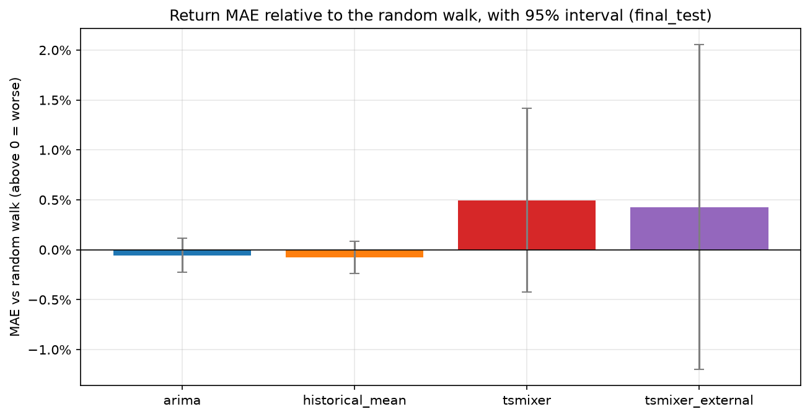
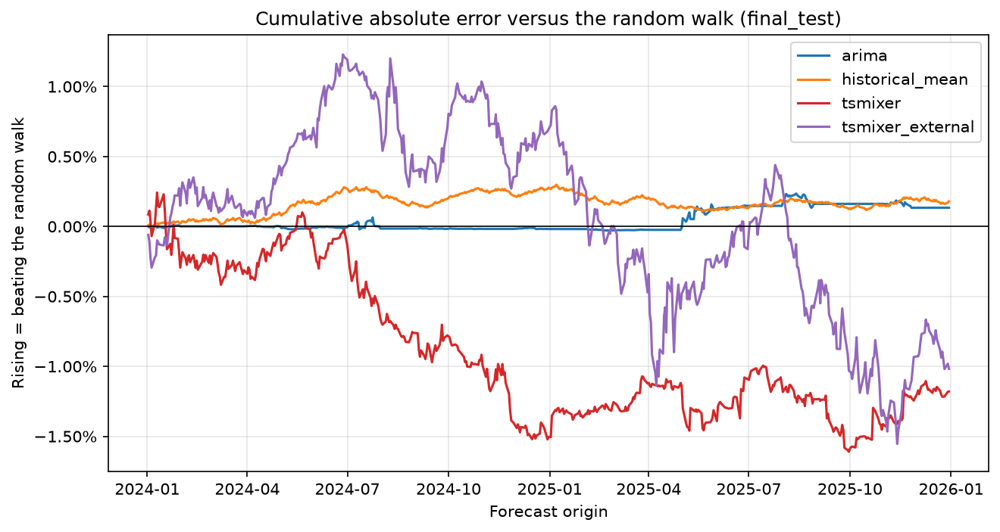
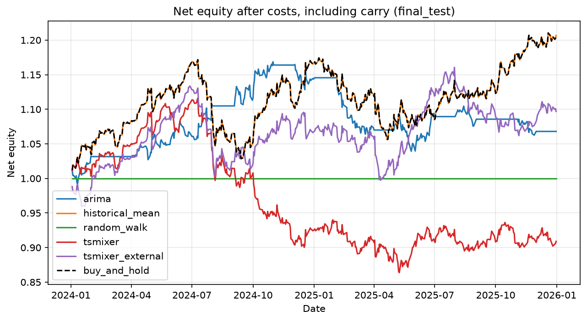
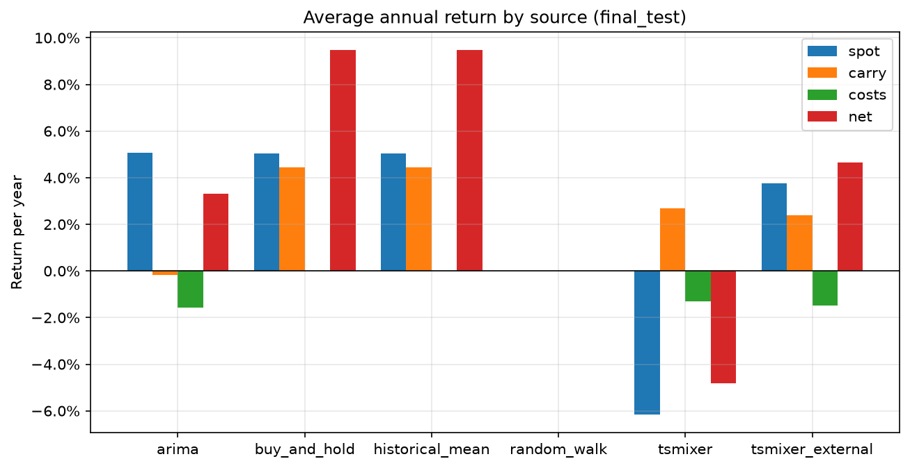
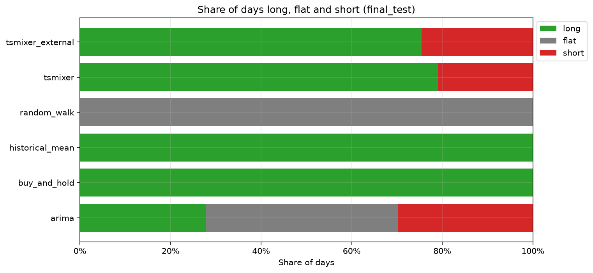
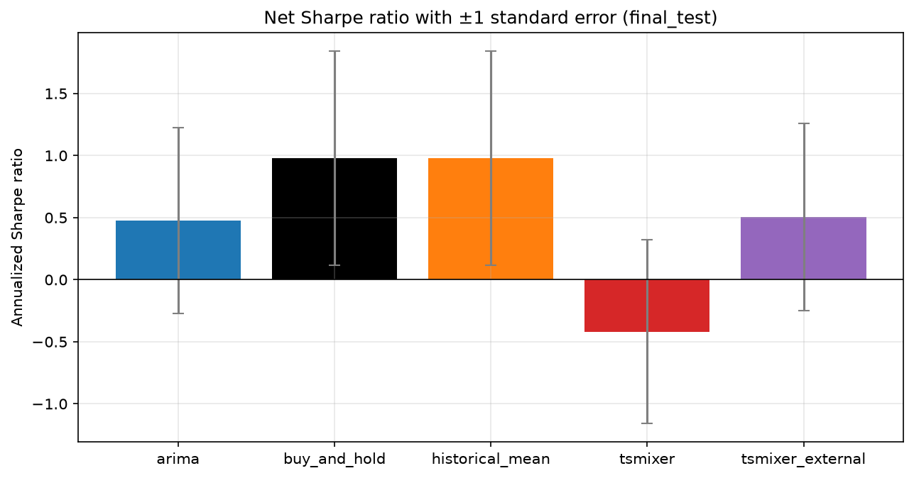
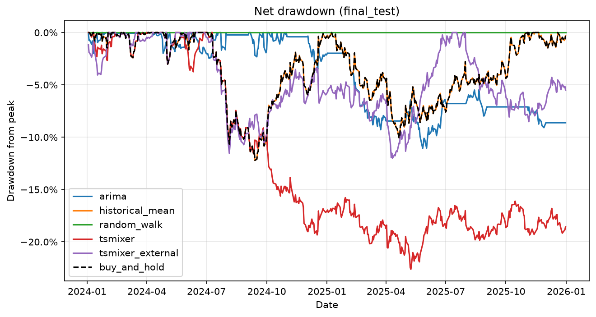

# USD/JPY next-day forecasting and trading

This project tests whether a TSMixer neural network can forecast the next-day return of USD/JPY better than simple benchmarks, and whether trading on its forecasts earns more than holding the currency pair with these evaluations: one-day forecasts, chronological walk-forward folds, and a random-walk benchmark.

The choice of TSMixer is inspired from [Enhancing Exchange Rate Forecasting with Explainable Deep Learning Models](https://arxiv.org/abs/2410.19241). That paper compared nine deep-learning models on the RMB/USD exchange rate, and TSMixer had the lowest or joint-lowest MAE and MSE at every prediction length it tested, from 16 to 64 days. This project tests whether that result carries over to a different currency pair, a one-day horizon, and a random-walk benchmark, which the paper did not include.

The pipeline uses daily FRED data from 2015 to 2025, retrains every model once a month, forecasts every trading day, and backtests a long-or-short strategy with transaction costs and interest-rate carry.

## Run the experiment

You need uv and Python 3.12. The input data is committed in `data/`.

1. Install the dependencies:

   ```bash
   uv sync --extra dev
   ```

2. Run validation mode. It trains and evaluates every model on 2022 to 2023 and writes the results to `outputs/`:

   ```bash
   uv run fx-runner --config configs/experiment.yaml --mode validation
   ```

3. To make the charts, open `notebooks/results.ipynb`, set `split = "validation"` in the first cell, and run all cells. The charts go to `images/validation/`.

4. When the configuration is final, run final mode. It evaluates the same models on 2024 to 2025:

   ```bash
   uv run fx-runner --config configs/experiment.yaml --mode final
   ```

   To chart the results, set `split = "final_test"` in `notebooks/results.ipynb`.

To run the tests, use `uv run pytest`.

## Ridge feature selection on the validation period

Before fixing the TSMixer feature sets, we checked whether any group of external features improves a simple linear forecast. [`notebooks/selection.ipynb`](notebooks/selection.ipynb) runs a ridge-regression forward selection on the validation period only.

The candidate groups are:

| Group | Features |
|---|---|
| `rates` | US and Japanese short rates, their daily changes, the US-Japan rate gap, and its daily change |
| `equities_and_risk` | Nikkei daily return, VIX, and the daily change in VIX |
| `oil` | WTI daily return |
| `macroeconomic_activity` | US CPI growth, US industrial-production growth, the 10-year minus 2-year Treasury yield, and its daily change |

For each of the 24 monthly validation folds:

1. Start from no features. With no features, the best forecast is the average return of the training data, which is the historical mean.
2. Rank the groups by the average size of their ridge coefficients when every group is included.
3. In that order, add a group only if it lowers the inner cross-validation MAE by more than 0.00001.

The inner cross-validation splits each fold's training data into 4 chronological blocks and scores 3 splits, each trained on the past with a one-day gap before the scored block. Missing values are filled with the training median and the features are standardized inside every split, so no look ahead. The ridge penalty (alpha) is chosen from 0.01 to 1,000 by the same inner cross-validation.

**Ridge selected no group in any of the 24 folds.** Every group, tested on its own, chose the largest alpha (1,000) in every fold. That shrinks its coefficients towards zero and pulls the forecast back towards the historical mean. The largest gain from any group in any fold was 0.000002, a fifth of the threshold, and `rates` and `macroeconomic_activity` made the error worse in every fold.

Ridge only finds linear relationships, and TSMixer is not linear. So the pipeline still runs two TSMixer models for comparison. `tsmixer` uses no features, which matches what ridge selected. `tsmixer_external` uses the `equities_and_risk`, `oil`, and `macroeconomic_activity` groups.

## What the pipeline does

The runner in `src/fx_forecasting/runner.py` does these steps in both modes:

1. Load the nine daily and monthly series in `data/` and align each one to the USD/JPY trading calendar. Each series has an availability lag in the config, so a value is used only after it would have been published. A check fails the run if any feature appears before its availability date.
2. Build the features and the target. The target is the log return of USD/JPY from day t to day t+1.
3. Split the test period into calendar months. For each month, train every model on all data up to that month, leaving one day as a gap, then forecast every day in the month.
4. Turn each forecast into a position. A positive forecast goes long USD/JPY (+1), a negative forecast goes short (-1), and a forecast of exactly 0 stays flat.
5. Backtest the positions with carry and costs, then write the forecasts, backtests, and metric tables.

The models are:

| Model | Forecast |
|---|---|
| `random_walk` | Always 0, which means no change in the rate. This is the standard benchmark for exchange-rate forecasts. |
| `historical_mean` | The average daily return in the training data. |
| `arima` | ARIMA(p, 0, q) on daily returns, with p and q up to 2 chosen by AICc each month. |
| `tsmixer` | Darts `TSMixerModel` on USD/JPY's own past returns only, with no extra features. |
| `tsmixer_external` | The same model, plus Nikkei, VIX, oil, US inflation, industrial production, and yield-curve features. |

The trading benchmarks are `buy_and_hold`, which is always long, and `cash`, which never trades.

## Final-test results (2024 to 2025)

Final mode forecast 500 trading days, from 2024-01-02 to 2025-12-30, in 24 monthly folds. Every TSMixer fold trained without failure. USD/JPY rose from 143.55 to 156.80 over the period, and long positions earned about 4.4% a year in carry because US rates were far above Japan's.

No model forecasts the next-day return better than the random walk, and no strategy beats buy-and-hold.

| Model | Net Sharpe | Net cumulative return | Max drawdown |
|---|---|---|---|
| `buy_and_hold` | 0.98 | 20.7% | -12.2% |
| `historical_mean` | 0.98 | 20.7% | -12.2% |
| `tsmixer_external` | 0.51 | 9.7% | -12.0% |
| `arima` | 0.47 | 6.8% | -11.1% |
| `tsmixer` | -0.42 | -9.1% | -22.6% |

Validation (2022 to 2023) shows the same pattern. The ranking of the two TSMixer models is not stable, though. `tsmixer` had the best model Sharpe ratio in validation (1.19, close to buy-and-hold's 1.24) and the worst in the final test (-0.42). Its forecast accuracy barely changed between the two periods.

### Forecast accuracy against the random walk



Each bar shows how much larger a model's mean absolute error (MAE) is than the random walk's. Above 0 means worse than forecasting no change. The whiskers are 95% intervals from a Diebold-Mariano (DM) test on the daily absolute errors.

ARIMA and the historical mean are within 0.1% of the random walk. `tsmixer` is 0.50% worse (DM 1.06) and `tsmixer_external` 0.43% worse (DM 0.52). Every interval crosses 0, so no model's forecasts are measurably better or worse than forecasting no change. Adding the external features did not change TSMixer's accuracy either.

### When each model gains or loses against the random walk



Each line adds up the random walk's daily absolute error minus the model's. A rising line means the model beats the random walk over that stretch. A falling line means it loses.

The historical mean and ARIMA stay within 0.3 percentage points of zero for the whole period. `tsmixer` falls mostly from July to December 2024, around the Bank of Japan's rate rise and the yen rally that followed, and ends 1.2 points behind. `tsmixer_external` gains 1.2 points by mid-2024, then gives it all back from early 2025 and ends 1.0 point behind.

### Net equity



Net equity is the value of 1 dollar put into each strategy on the first day, after transaction costs and including carry. Compare each line with the dashed buy-and-hold line, not with 1.0. USD/JPY rose and long positions earned carry, so any strategy that is mostly long drifts upward.

The historical-mean line is hidden under buy-and-hold. The average daily return was positive in every training window, so the model was long every day and made the same trades. The flat stretches in ARIMA are months when AICc chose ARIMA(0, 0, 0). That model forecasts exactly 0, so ARIMA held no position. This happened in 10 of the 24 months. The random walk never trades and stays at 1.0.

`tsmixer` lost 16.5% from July to December 2024, while buy-and-hold ended that stretch flat. Most of the loss came in October and November 2024. USD/JPY rebounded from 143.7 to 150.4, `tsmixer` was short on 37% of those days, and it lost 9.3% while buy-and-hold gained 5.8%. It never recovered and ended at 0.91.

### Where the returns come from



The bars split each strategy's average yearly return into the USD/JPY move (spot), the interest-rate carry, and transaction costs. These are simple averages, so the net bar differs slightly from the compounded return in the metrics table.

Buy-and-hold earned about 5.0% a year from spot and 4.4% from carry, at almost no cost. The TSMixer models traded 131 and 149 times, and costs took 1.3% and 1.5% a year. They also earned only about half of buy-and-hold's carry, because every short day pays the rate gap instead of earning it. `tsmixer` lost 6.2% a year on spot, while `tsmixer_external` gained 3.8%.

### Share of days long, flat, and short



`tsmixer` was long on 79% of days and `tsmixer_external` on 75%. The historical mean and buy-and-hold were always long. ARIMA was long on 28%, flat on 42%, and short on 30%. Being long most of the time was not enough on its own. `tsmixer` was long more often than `tsmixer_external` but lost money.

### Risk-adjusted return



The net Sharpe ratio is the mean daily net return divided by its standard deviation, multiplied by the square root of 252. The whiskers are one standard error, assuming independent daily returns.

Buy-and-hold is at least as good as every model. Only `tsmixer` is reliably worse. The gaps for `tsmixer_external` (z = -0.66) and ARIMA (z = -0.50) are within noise.

### Drawdown



Drawdown is how far a strategy is below its own previous peak. Buy-and-hold's worst drawdown was 12.2%, during the July to September 2024 yen rally. `tsmixer_external` and ARIMA had similar worst drawdowns, 12.0% and 11.1%, without the matching return. `tsmixer` fell furthest, 22.6% by May 2025, and stayed below its July 2024 peak for the rest of the period.

## Outputs

Each run writes CSV files with a `validation_` or `final_test_` prefix.

| File | Contents |
|---|---|
| `outputs/forecasts/*_forecasts.csv` | One row per model and forecast day: the predicted return and level, the realized return and level, and the training window. |
| `outputs/tables/*_metrics.csv` | Forecast accuracy per model: MAE, RMSE, and directional accuracy. |
| `outputs/tables/*_strategy_metrics.csv` | Trading results per strategy, with and without costs: Sharpe ratio, annualized return, drawdown, turnover, and trade count. |
| `outputs/tables/*_model_metadata.csv` | One row per model and month: the chosen ARIMA order, TSMixer epochs, runtimes, and any failure reason. |
| `outputs/backtests/*_signals.csv` | The daily position of each model. |
| `outputs/backtests/*_daily.csv` | Daily returns, carry, costs, equity, and drawdown per strategy. |
| `outputs/tables/walk_forward_folds.csv` | The training, gap, and forecast dates of each validation month. |

## Configuration

Settings live in `configs/experiment.yaml`:

- `periods` sets the development, validation, and final-test date ranges.
- `datasets` lists each input file with its availability lag and the maximum age before a value counts as stale.
- `models.arima` and `models.tsmixer` hold the model settings.
- `models.tsmixer.feature_sets` defines the TSMixer variants. Each entry trains a separate model named after its key. To add a variant, add a line with a new name and feature list. An empty list (`[]`) trains on past returns only.
- `signal_threshold` is the forecast size below which a model stays flat. It is 0, so every non-zero forecast trades.
- `transaction_cost` is the cost per unit of position change, currently set at 1 basis point.

## Trade-offs

- **Monthly retraining.** Each mode trains every model 24 times, once per month. Daily retraining would mean about 500 fits per mode, roughly 20 times the runtime. The model inputs still update every day. Only the learned parameters are up to a month old.
- **A small TSMixer on the CPU.** TSMixer uses a 32-day lookback, a hidden size of 64, and 2 mixer blocks. Early stopping ends training after 10 epochs without improvement, which in validation happens after 11 to 24 epochs. Training runs on the CPU so results are identical between runs. 
- **One seed and no hyperparameter search.** Each model trains once with a fixed seed and fixed settings. A search over settings would use up the validation period as an honest check.
- **A one-day horizon.** TSMixer predicts one value per day. Longer horizons would cost 2 to 6 times the training time if the model outputs the whole path.
- **Fixed feature sets.** The two TSMixer models use feature lists fixed in advance.
- **Simple preprocessing.** TSMixer fills missing feature values with the median of its training data and standardizes with a scaler fitted on the same data.
- **Approximate carry.** Positions earn or pay `us_rate - jp_rate` at the rates known when the position opens, on an actual/365 basis. The backtest does not model forward points or financing spreads.


## Future additions

- **Longer horizons and lookback window.** Forecast the cumulative return over the next 20 days. Slow-moving macro features are more likely to matter at that horizon than at one day.
- **Market regime features.** Engineer / encode features that describe market conditions for market regime detection that can be fed into the model to learn from.
- **Relative-equity charts.** Plot each strategy's equity divided by buy-and-hold, and report alpha and beta against buy-and-hold.
- **More models.** The paper's other models, such as FEDformer and iTransformer, through the same walk-forward folds.


